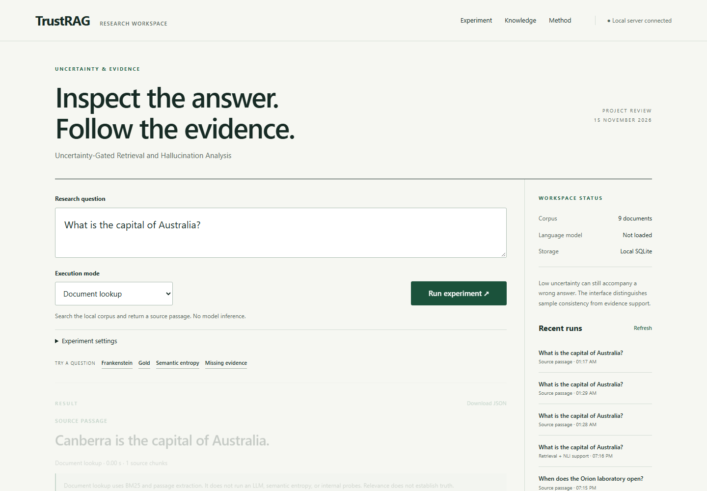

# TrustRAG

**Uncertainty-Gated Retrieval and Hallucination Analysis**

TrustRAG is a local research application that uses document retrieval, uncertainty estimates, and internal model signals to inspect whether generated answers agree with available evidence.

[Presentation](presentation/final/TrustRAG_Project_Review.pptx) · [Review and results](docs/REVIEW_AND_RESULTS.md) · [Short description](docs/PROJECT_DESCRIPTION.md)



## Run

Python 3.12 is the verified local environment. From this repository:

```powershell
python -m venv .venv
.venv\Scripts\python.exe -m pip install -r requirements-model.txt
.venv\Scripts\python.exe scripts/download_models.py
.venv\Scripts\python.exe run.py --model
```

Open http://127.0.0.1:8000. Cached model assets are required for model mode. The explicit download command fetches pinned model revisions into `.models/`; application startup uses the cache. No cloud inference or paid API key is required.

For document lookup only, install `requirements.txt` and run `python run.py` without `--model`. This mode uses BM25 and passage extraction, without LLM inference.

## Current implementation

- Local SmolLM2-135M-Instruct generation and MiniLM NLI, on CPU or CUDA.
- BM25 retrieval from an attributed starter corpus and user-supplied plain text.
- Semantic entropy from bidirectional NLI clusters of sampled answers.
- A fitted logistic detector using ReDeEP-inspired ECS/PKS tensor measurements.
- Guarded attention/FFN correction, sentence-level support checks, numeric guards, and abstention.
- SQLite corpus/history, browser controls, execution traces, and JSON export.

Model runs default to **always retrieve**. Adaptive gating and no-retrieval generation are available as experimental configurations. Adaptive low-entropy acceptance is explicitly unverified. The always-retrieve path makes one contextual generation call and skips sampling. Correction-off skips the internal probes.

The app automatically loads `artifacts/calibration.json`. `--calibration path.json` selects another fitted profile. The pretrained language-model weights remain frozen; calibration trains the small detector and selects components from candidates.

## Recorded results

The detector used 64 controlled fictional claims with separate source groups for train/validation/test. Its 16-claim test split gave AUROC **0.734** and F1 **0.50**. A separate eight-question comparison passed the opening-time check for retrieval variants, while adaptive routing added latency and triggered no correction. These results do not establish broad factual reliability or a correction benefit.

The historical comparison includes an initial generation that the reviewed always-retrieve path removes. See [review and results](docs/REVIEW_AND_RESULTS.md) for scoring and timing boundaries. Original experiment records stay preserved.

## Verify and reproduce

```powershell
.venv\Scripts\python.exe -m pytest -q
.venv\Scripts\python.exe scripts/verify_release.py
.venv\Scripts\python.exe scripts/calibrate.py
.venv\Scripts\python.exe scripts/benchmark.py
```

`verify_release.py` exercises cached real weights. Calibration selects components on training groups, chooses the threshold on validation groups, and evaluates test groups. `--dataset` accepts rows containing `group`, `split`, `query`, `context`, `answer`, and binary `hallucinated`. Identical contexts and source groups cannot cross splits.

The benchmark compares no retrieval, always retrieval, adaptive without correction, and adaptive with guarded correction on the controlled test questions. It records outputs, tokens, and latency. The metric is an opening-time extraction and NLI support proxy. Larger independent evaluation is still required.

Optional Kaggle tooling is in `requirements-research.txt` and `scripts/package_kaggle.py`. Upload and compute use require the account owner's authorization. Credentials and personal documents never enter the allowlisted bundle.

## Project structure

| Path | Purpose |
| --- | --- |
| `backend/` | API, pipeline, inference, calibration, evidence checks, retrieval, storage |
| `webapp/` | Responsive local research interface |
| `data/` | Starter reference summaries and controlled examples |
| `artifacts/` | Fitted detector and provenance |
| `scripts/` | Setup, evaluation, verification, and packaging |
| `tests/` | Regression checks |
| `reports/` | Recorded experiment and release evidence |
| `presentation/final/` | Reviewed PowerPoint |
| `docs/` | Results, project description, presenter guide, email draft |

API documentation is available at http://127.0.0.1:8000/docs. The app binds to localhost and is intended for a single local user. Credentials, downloaded weights, and user records are excluded from Git.

## Research references

- Ding et al., [Rowen](https://arxiv.org/abs/2402.10612), SIGIR-AP 2025.
- Sun et al., [ReDeEP](https://arxiv.org/abs/2410.11414), ICLR 2025.
- Farquhar, Kossen, Kuhn and Gal, [Detecting hallucinations in large language models using semantic entropy](https://www.nature.com/articles/s41586-024-07421-0), Nature 630 (2024).

TrustRAG adapts these ideas. It does not reproduce the full ReDeEP component-selection and benchmark procedure. NLI and numeric checks are imperfect, low entropy can accompany a wrong answer, and the current controlled dataset supports limited conclusions.
